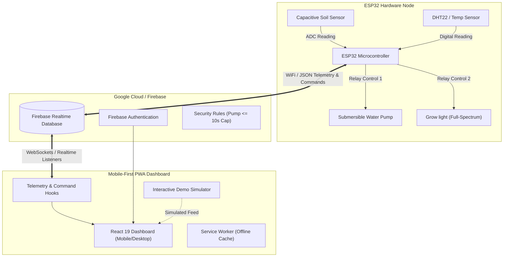

# PlantCare — Household Plant Caring System Dashboard

[](docs/security-audit-report.md)
[](package.json)
[](package.json)
[](src/index.css)
[](vite.config.ts)
[](public/manifest.json)
[](LICENSE)

A high-reliability, mobile-first **Progressive Web App (PWA)** dashboard engineered for an automated **Household Plant Caring System**. Built for seamless bidirectional telemetry and control with an **ESP32 microcontroller** hardware node via **Firebase Realtime Database**.

---

## 📑 Table of Contents
- [System Architecture](#system-architecture)
- [Key Features](#key-features)
- [Hardware Communication Contract](#hardware-communication-contract)
- [Getting Started](#getting-started)
- [Mock Device Simulator (Zero Hardware)](#mock-device-simulator-zero-hardware)
- [Demo Mode](#demo-mode)
- [Testing & Quality Assurance](#testing--quality-assurance)
- [Security & Failsafe Measures](#security--failsafe-measures)
- [Production Deployment](#production-deployment)
- [Team Handover Notes](#team-handover-notes)
- [Project Documentation](#project-documentation)

---

## 🏛️ System Architecture



---

## ✨ Key Features

1. **Live Telemetry Monitoring:**
   - Real-time soil moisture percentage with color-coded health status badges (Dry, Optimal, Wet).
   - Ambient temperature (°C) gauge with warm/cool thermal indicators.
   - Actuator status indicators for Water Pump (`IDLE` / `PUMPING`) and **Grow light** (`OFF` / `ACTIVE`).
   - Multi-device selector supporting multiple monitored plant nodes (`plant1`, `plant2`, `plant3`).

2. **Automated Offline Detection & Safety Lock:**
   - Instant visual warning banner when hardware heartbeat exceeds 30 seconds.
   - Live "Last seen X seconds ago" counter.
   - Automatically **disables manual control buttons** during offline periods to prevent command queue desynchronization.

3. **Curated Plant Presets:**
   - **Succulent / Cactus:** 15% – 30% moisture (2s safe pulse, 14h photoperiod)
   - **Foliage / Tropical (e.g. Monstera):** 40% – 65% moisture (4s safe pulse, 12h photoperiod)
   - **Herbs (e.g. Basil, Mint):** 50% – 70% moisture (3s safe pulse, 14h photoperiod)
   - **Fern / Moisture-loving:** 60% – 80% moisture (5s safe pulse, 10h photoperiod)

4. **Custom Profile & Threshold Configuration:**
   - Accessible accordion configuration form with strict numeric validation.
   - Prevents invalid boundaries (`min_moisture < max_moisture`), validates photoperiods (0–24h), and caps watering pulses (1–10s).

5. **Manual Controls & Dual-Mode Grow Light:**
   - **"Water Now" Button:** Optimistic loading spinner with 10s acknowledgment confirmation timeout from hardware node.
   - **"Grow light" Dual Mode:** Switch seamlessly between **Automatic Schedule** (based on profile photoperiod hours) and **Manual Override** (instant toggle).
   - *Strict Nomenclature Rule:* Actuator is strictly labeled **"Grow light"** throughout the entire application.

6. **Historical Telemetry Chart:**
   - Powered by Recharts with dual zoom views: **1 Hour** (high-resolution minute trends) and **24 Hours** (long-term diurnal cycles).
   - Dual-axis display for Soil Moisture (%) and Temperature (°C).

7. **Zero-Hardware Demo Mode & Simulator:**
   - Toggleable from the header banner for instant classroom or presentation evaluation with zero cloud or hardware credentials.
   - Standalone Node.js simulator script (`npm run mock-device`) for end-to-end Firebase testing.

8. **PWA & Mobile-First Polish:**
   - Full Web App Manifest with icons, theme colors, and standalone display mode.
   - Cache-first Service Worker for offline asset access.
   - Adaptive responsive design down to 360px viewport widths with dual Light / Dark mode.

---

## 📡 Hardware Communication Contract

All communication between the ESP32 node and the dashboard flows through Firebase Realtime Database at `/devices/{deviceId}`:

| Path | Directed | Purpose | Example Payload |
|---|---|---|---|
| `/devices/{id}/telemetry/reading` | ESP32 ➔ Cloud | Live telemetry & heartbeat | `{"moisture_percent": 42.5, "temperature_c": 24.1, "pump_active": false, "grow_light_active": true, "timestamp": 1731000000000}` |
| `/devices/{id}/telemetry/history` | ESP32 ➔ Cloud | Periodic historical log | `{"ts1": {"moisture_percent": 41, "temperature_c": 24, "timestamp": 1731000000000}}` |
| `/devices/{id}/command` | Dashboard ➔ ESP32 | Actuator overrides | `{"water_now": true, "pump_duration_seconds": 3, "grow_light_mode": "manual", "grow_light_manual_state": true, "timestamp": 1731000000000}` |
| `/devices/{id}/profile` | Dashboard ➔ ESP32 | Target thresholds | `{"preset_name": "Tropical", "min_moisture": 40, "max_moisture": 65, "pulse_duration_seconds": 4, "photoperiod_hours": 12}` |

For exhaustive schema specifications, handshake contracts, and edge-case behavior, see [`docs/contract.md`](docs/contract.md).

---

## 🚀 Getting Started

### Prerequisites
- [Node.js](https://nodejs.org/) (version 20 or higher recommended)
- `npm` (version 10 or higher)

### Installation
```bash
# Clone the repository
git clone https://github.com/your-team/plant-care-app.git
cd plant-care-app

# Install dependencies
npm install
```

### Environment Configuration
Copy the `.env.example` file to `.env.local`:
```bash
cp .env.example .env.local
```
Fill in your Firebase project credentials in `.env.local`:
```env
VITE_FIREBASE_API_KEY=your_api_key
VITE_FIREBASE_AUTH_DOMAIN=your_project.firebaseapp.com
VITE_FIREBASE_DATABASE_URL=https://your_project-default-rtdb.firebaseio.com
VITE_FIREBASE_PROJECT_ID=your_project
VITE_FIREBASE_STORAGE_BUCKET=your_project.appspot.com
VITE_FIREBASE_MESSAGING_SENDER_ID=your_sender_id
VITE_FIREBASE_APP_ID=your_app_id
```
> [!NOTE]
> If credentials are not configured, the app will gracefully run in **Demo Mode**, generating synthetic physical plant telemetry so you can evaluate the entire dashboard without any backend setup!

### Running Development Server
```bash
npm run dev
```
Open your browser at `http://localhost:3000`.

---

## 🤖 Mock Device Simulator (Zero Hardware)

To test the entire bidirectional loop against a real Firebase instance without physical hardware:

```bash
# Starts simulated ESP32 node 'plant1' transmitting realistic soil drying and temperature fluctuations
npm run mock-device
```

The simulator:
- Transmits realistic capacitive telemetry readings every 5 seconds.
- Simulates soil moisture drying over time.
- Listens for `command/water_now` pulses, flips `pump_active = true` for the requested duration, and boosts soil moisture.
- Manages grow light state according to manual commands or schedule photoperiods.

---

## 🧪 Testing & Quality Assurance

Our test suite contains **70 automated tests across 13 test files**, verifying component rendering, hook behavior, state transitions, validation logic, and security constraints:

```bash
# Run the complete test suite once
npm test

# Run tests in watch mode
npm run test:watch

# Run linter
npm run lint

# Format code with Prettier
npm run format
```

### Test Suite Summary
| Suite | File | Tests | Coverage Scope |
|---|---|---|---|
| **App Shell** | `src/test/App.test.tsx` | 8 | Main layout, theme toggle, grow light label verification |
| **Telemetry Cards** | `src/test/dashboard.test.tsx` | 8 | Moisture, temperature, and actuator card states |
| **Offline Detection** | `src/test/offlineDetection.test.tsx` | 6 | Heartbeat stale detection (>30s), banner, and control locks |
| **Plant Presets** | `src/test/presets.test.tsx` | 6 | Preset switching, profile updates, and active badges |
| **Custom Settings** | `src/test/customSettings.test.tsx` | 8 | Input bounds validation, error handling, saving |
| **Manual Controls** | `src/test/manualControls.test.tsx` | 6 | Water pulse trigger, acknowledgment timeout, grow light toggle |
| **History Chart** | `src/test/historyChart.test.tsx` | 3 | Recharts data ingestion, 1h vs 24h view toggles |
| **Demo Simulator** | `src/test/demoMode.test.tsx` | 6 | Synthetic telemetry generator, moisture decay, water response |
| **Authentication** | `src/test/auth.test.tsx` | 4 | Email/password form, guest evaluator 1-click access |
| **PWA & Manifest** | `src/test/pwa.test.ts` | 3 | Manifest structure, service worker file verification |
| **Security Audit** | `src/test/securityReview.test.ts` | 5 | Zero `eval`/`dangerouslySetInnerHTML`, 0 `UV light`, RTDB rules |
| **Device Simulator** | `src/test/mockDevice.test.ts` | 5 | Virtual ESP32 node state transitions and command responses |
| **Firebase Services** | `src/test/firebase.test.ts` | 2 | App initialization and database references |

---

## 🔒 Security & Failsafe Measures

- **Zero Arbitrary Execution:** Zero usage of `eval()`, `new Function()`, or `dangerouslySetInnerHTML`.
- **Database Safety Cap:** Firebase RTDB rules strictly reject pump durations greater than 10 seconds:
  ```json
  "pump_duration_seconds": {
    ".validate": "newData.isNumber() && newData.val() >= 1 && newData.val() <= 10"
  }
  ```
- **Stale Command Expiration:** The ESP32 and simulator ignore commands older than 30 seconds to prevent sudden actuator activation after network reconnection.
- **Fail-Safe Offline Controls:** If sensor telemetry has not been received within 30 seconds, manual watering and light controls are disabled.
- **Strict Nomenclature:** The actuator is strictly labeled **"Grow light"** (never "UV light") to prevent user confusion regarding plant photobiology.

See [`docs/security-audit-report.md`](docs/security-audit-report.md) for full audit documentation.

---

## 🌐 Production Deployment

### Build for Production
```bash
npm run build
```
The optimized production bundle is generated in the `dist/` directory.

### Preview Local Production Build
```bash
npm run preview
```

### Deploying to Firebase Hosting
```bash
# Login to Firebase
npx firebase login

# Deploy hosting and database security rules
npx firebase deploy
```

### Deploying to Vercel
1. Link your repository in Vercel.
2. Set Build Command to `npm run build` and Output Directory to `dist`.
3. Add environment variables from `.env.local` in Vercel Project Settings.

---

## 👥 Team Handover Notes

For detailed hardware schematics, pin mappings, ESP32 Arduino C++ firmware snippets, database deployment instructions, and QA demo checklists, consult:

👉 **[`docs/handover-notes.md`](docs/handover-notes.md)**

- **Member 1 (Firmware / ESP32 Lead):** JSON payloads, command handshake, WiFi reconnection logic.
- **Member 2 (Hardware / Circuit Lead):** Sensor ADC calibration, relay driving circuits, power decoupling.
- **Member 3 (Backend / Cloud Lead):** RTDB security rules, Firebase project setup, indexing.
- **Member 4 (App & UI/UX Lead - Pruthviraj):** PWA architecture, testing suites, responsive design.
- **Member 5 (QA & Documentation Lead):** Test plans, demo rehearsal scripts, edge cases.

---

## 📚 Project Documentation

- [`docs/contract.md`](docs/contract.md) — Comprehensive Firebase RTDB communication contract.
- [`docs/design-system.md`](docs/design-system.md) — Color tokens, typography, component styling guidelines.
- [`docs/tickets.md`](docs/tickets.md) — Project roadmap from Ticket A-00 to A-14.
- [`docs/security-audit-report.md`](docs/security-audit-report.md) — Automated security audit findings.
- [`docs/grilling.md`](docs/grilling.md) — Architectural design decisions and rationale.
- [`docs/prompts.md`](docs/prompts.md) — Prompt evolution log and development trajectory.

---

## 📄 License
This project is open-source and licensed under the [MIT License](LICENSE).
